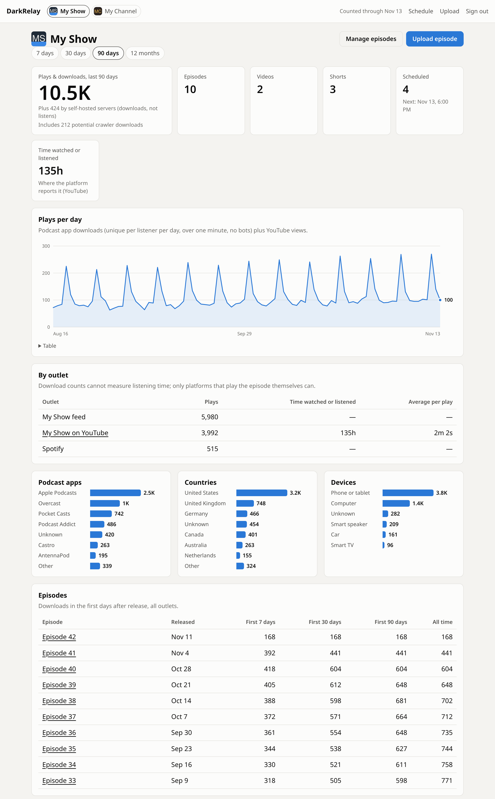
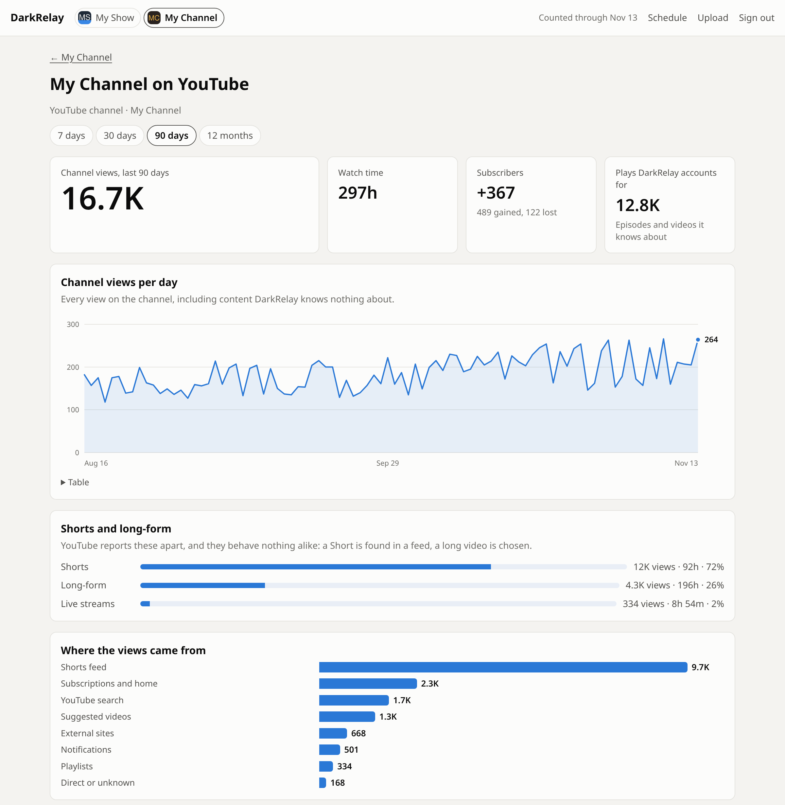

# DarkRelay

[](https://github.com/chaotictoejam/darkrelay/actions/workflows/ci.yml) [](LICENSE)

Self-hosted, serverless podcast hosting and analytics on AWS. It is the publishing half of [Darkroom](https://github.com/chaotictoejam/darkroom): Darkroom records, edits and exports; DarkRelay publishes and measures.

One upload in. An RSS feed (iTunes and Podcasting 2.0 tags) out, served from your own AWS account, with your own download logs.

**Status:** hosting, feeds, import and migration, download analytics, the dashboard, video and YouTube are all built. DarkRelay is now organised around [brands and outlets](#brands-and-outlets): not every brand is a podcast. See [Roadmap](#roadmap).



<sup>A brand page in the dashboard. The screenshots in this README are of a real build filled with placeholder brands and invented numbers.</sup>

## Quickstart

About **$1-4 a month** at personal scale ([cost breakdown](#cost)). You need Node 22+, Docker or Podman (for the transcoder image), AWS credentials, and the account [bootstrapped for CDK](https://docs.aws.amazon.com/cdk/v2/guide/bootstrapping.html) in us-east-1.

```bash
git clone https://github.com/chaotictoejam/darkrelay && cd darkrelay
npm install
cp darkrelay.config.example.json darkrelay.config.json   # set your domain, or leave it out
npm run deploy
npx darkrelay show put my-show.json --image cover.jpg     # start from examples/show.example.json
npx darkrelay show go-live my-show                       # new shows start as drafts
npx darkrelay publish "Episode 1.mp3" --show my-show --title "Episode 1" --notes notes.html
```

Moving an existing show? Start with [Moving a show from another host](#moving-a-show-from-another-host). Full details are under [Deploy](#deploy) and [Use](#use).

## How it works

```
darkrelay publish ──► S3 inbox/ ──(EventBridge)──► Publisher Lambda ──► S3 public/ ◄── CloudFront ◄── podcast apps
                                                     │ validates bundle               │
                                                     │ writes manifest                └─► access logs (Parquet) ─► S3
                                                     │ rebuilds + validates feed
                                                     └ invalidates feed, pings Podcast Index
```

- **Downloads never touch Lambda, a database or the dashboard.** CloudFront serves media and feeds straight from S3. If anything else breaks, episodes still download.
- **Feeds are static files**, rebuilt on every publish. A feed that fails validation is never written: the last good one stays up and the errors are saved for `darkrelay status`.
- **Several brands per deployment.** A brand with a feed serves it at `https://<your-domain>/<brand>/feed.xml`; a brand with only a YouTube channel has no feed at all.
- **Scheduled releases**: publish ahead of time with a future `--pub-date`; see below.

## Brands and outlets

DarkRelay publishes and measures **brands**. A brand is the thing with an audience; its **outlets** are the places its content goes out.

```
Brand (slug, name, icon)
├── Outlets: rss | youtube | spotify | apple   (more than one of a kind is allowed)
└── Content: episodes today
```

Content belongs to the brand, not to an outlet. So one brand can be a podcast that also posts to YouTube, and another can be a YouTube channel with no feed anywhere.

| Outlet kind | What it is |
| --- | --- |
| `rss` | A feed DarkRelay hosts, at `/<show>/feed.xml`. Its feed config (title, categories, `podcast:guid`) stays in `show.json`, where the publisher reads it. |
| `youtube` | A channel connected with `darkrelay youtube connect`. The outlet wraps the connection; the OAuth token stays in SSM, untouched. |
| `spotify`, `apple` | Measured, not published to: they take numbers from the platform's own exports. |

A brand is stored at `catalog/<slug>/brand.json`. **The publisher never reads it**, so a brand change can never affect a feed.

### Shows are brands

Every show you already have is a brand with the same slug: same feed URL, same `podcast:guid`, same episode `<guid>`s, same analytics keys. `show put` writes `brand.json` for a new show; write it for the shows you already have with:

```bash
npx darkrelay brand migrate --dry-run   # list what it would write
npx darkrelay brand migrate
```

The migration only adds a file. It copies nothing, moves nothing and rewrites no analytics: the brand takes its name from the feed title, its icon from the show artwork, and its outlets from the feed and the show's YouTube connection. Reads do not wait for it either — a show with no `brand.json` is read as the brand it will become.

`--show` is now the old name of `--brand` and both work everywhere (`publish`, `import`, `dashboard add-user`, `dashboard set-role`). Commands that take a slug as an argument are unchanged.

### Managing brands

```bash
npx darkrelay brand list
npx darkrelay brand get my-brand > my-brand.json   # edit it, then put it back
npx darkrelay brand put my-brand.json --icon icon.png
npx darkrelay brand icon my-brand icon.png         # square JPEG or PNG, 128-3000 px, under 2 MB
                                                   # (or click the icon on the brand's dashboard page)
npx darkrelay brand outlet add my-brand --kind youtube --connection my-channel
npx darkrelay brand outlet add my-brand --kind spotify --url https://open.spotify.com/show/xxxx
npx darkrelay brand outlet remove my-brand spotify
```

Copy `examples/brand.example.json` for a starting point. Outlet ids default to the kind, so a brand's first feed is `rss` and its first channel `youtube`; pass `--id` to add a second of the same kind. The icon is a square image in the media bucket, shown in the dashboard nav and on brand pages.

Removing an outlet stops counting it and nothing else: the feed keeps serving and the channel keeps its videos. To stop publishing a feed, use `darkrelay show draft <slug>`.

### YouTube channels as outlets

A channel is an outlet like any other, and a brand can be nothing but a channel. Connect it once, and the connection names the brand it belongs to:

```bash
npx darkrelay youtube connect my-channel --brand my-channel   # creates the brand if it is new
npx darkrelay youtube backfill my-channel --from 2024-01-01   # read the channel's history
```

`connect --brand` stores the OAuth token in SSM exactly as before, then adds (or updates) that brand's `youtube` outlet with the channel's id and title. A brand that does not exist yet is created, named after the channel; it has no feed, and nothing about it expects one. For a podcast whose episodes should keep uploading automatically, also keep `"youtube": { "connection": "..." }` in the show file: that is what the uploader reads.

`backfill` lists the channel's uploads, so every video is recorded even if nobody watched it in the range, and then reads the daily detail of whatever had views. It is safe to repeat: re-reading a day overwrites it.

What a channel outlet measures:

|  | Where it goes |
| --- | --- |
| An episode's own video | That episode, as before. Views count as plays beside its downloads. |
| Any other video or Short | A video of the brand, keyed by YouTube's id (`S#<brand>#V#<videoId>`). No title matching: it is the channel's, so it is the brand's. |
| The channel itself | The outlet (`S#<brand>#O#<outlet>`): views, watch time, subscribers gained and lost, where views came from, and the Shorts/long-form split. |

Channel numbers are **never** added into brand totals. A channel counts views of everything on it, including videos DarkRelay knows nothing about, so the outlet page shows both: what the channel did, and what DarkRelay can account for.

Shorts are identified by YouTube's own `creatorContentType`, not by duration — a three-minute talk is not a Short. Where YouTube reports nothing for a video (no views in the range), duration is the fallback.

A channel that is not connected yet, or whose token has been revoked, is logged and skipped: the other outlets and the other brands still run.

### Videos and Shorts

Not everything a brand publishes is an episode. A **video** or a **Short** belongs to the brand, goes to one of its outlets, and has no feed: there is nothing to put an RSS item in, and no reason for a public URL to exist before the platform publishes it.

| Kind | Where its record lives |
| --- | --- |
| `episode` | Its own manifest, as always. The feed is built from those, and nothing here changes that. |
| `video`, `short` | `catalog/<brand>/content/<id>.json`, with the media private beside it. |

A Short may name the episode it was clipped from (`parentId`); a standalone Short names nothing, which is a normal thing for it to be.

**A batch** is a directory holding `shorts.json` and the files it names. Copy `examples/shorts.example.json` to start:

```bash
npx darkrelay shorts put ./december-clips --brand my-brand --dry-run   # look first
npx darkrelay shorts put ./december-clips --brand my-brand
npx darkrelay shorts list my-brand
```

The media and the manifest go to the inbox the way an episode bundle does, and the manifest goes last, because its arrival is what starts the ingest. A batch is all-or-nothing: if one entry names a file that is not there, or a `parentId` that matches no episode, nothing is written at all. Re-uploading a batch refreshes the copy but never rewinds an outlet that already has the video.

**Or from the dashboard**, with no manifest to write: _Upload Shorts_ on a brand page (`#/shorts/<brand>`) takes the clips — and any JPEG or PNG picked with them, as thumbnails — and builds `shorts.json` from the form. One row per clip: title, description, tags, which episode it came from, its thumbnail and its slot, with a shared description and tags for the ones that have none of their own. The bytes go straight from the browser to S3 in parts, exactly as an episode upload does, and the manifest is written last and once. The schema, the files named and the outlet are checked before it is written, so a mistake comes back to the form rather than arriving as a rejected batch. This is the one upload path that works for a brand with no feed, because a Short goes to a channel: the page needs `uploader` on the brand and a YouTube outlet to send to.

**Nothing is uploaded when you put a batch.** Each Short goes to YouTube a few days before its slot, as a private video with `publishAt`, and YouTube makes it public at that moment:

```bash
npx darkrelay shorts schedule my-brand bus-factor-clip-1a2b3c4d --at "2026-12-01 12:00"
npx darkrelay shorts schedule my-brand bus-factor-clip-1a2b3c4d --at now   # release it now
npx darkrelay shorts upload my-brand bus-factor-clip-1a2b3c4d              # upload ahead of the slot
npx darkrelay shorts sweep --lead-days 5                                   # run the hourly pass now
```

An hourly sweep uploads whatever is due, moves anything whose slot changed since it was uploaded, and **stops at five uploads per channel per day**. That cap is the point: a YouTube upload costs 1,600 of the default 10,000 daily quota units, so six is the ceiling, and a quarter's worth of Shorts must never go up at once. Items held back are reported and picked up the next day. Both numbers are configurable under `shorts` in `darkrelay.config.json`.

Uploading days ahead is also what makes an hourly pass precise enough: the slot is kept by YouTube, not by the sweep, so an hour of slack before the upload costs nothing.

An item with no slot is never uploaded.

**Slots can be moved from the dashboard too.** Every row on _Schedule_ — and everything still waiting for a slot — carries _Reschedule_ for anyone with `uploader` on that brand: a time, or _Release now_. A clip that has not gone up yet simply gets a new slot and is uploaded before it. One already sitting on YouTube as a private video is **moved, not re-uploaded**: the release time the platform is holding is changed, straight away rather than at the next sweep, and the video keeps its id and its URL. A video that is already public says so and stays where it is.

### Picking the slots

The YouTube Analytics API has no hour-of-day dimension, so there is no way to ask when an audience is awake. What it does report is how each video did, and DarkRelay knows when each one went out — so slots are scored from the brand's **own history**, bucketed by the day of week and hour it was published in, in the brand's own timezone.

```bash
npx darkrelay shorts slots my-brand                      # the week, as a heatmap
npx darkrelay shorts plan my-brand --weeks 6 --per-week 3
npx darkrelay shorts plan approve my-brand 20261112103000-7f3a21
```

Each video contributes three signals from its first 72 hours: views, the share of it that got watched, and subscribers gained per thousand views. Two things keep that honest on a channel with little data:

- **One viral Short cannot own a slot.** Every video is measured against the brand's own median and clamped at three times it, so a runaway hit counts as a good video, not as proof about an hour of the week.
- **A thin slot is pulled back toward a prior.** A bucket's score is mixed with a general peak-time prior in proportion to how little it holds, so one sample does not look like a finding. The prior is capped at the value of one typical slot, so a slot nothing is known about can never outrank one that has earned a better number.

A share of every plan — 20% by default, `--explore` to change it — goes to the **least-tested** slots rather than the best-scoring ones, and is marked `*` in the plan. Without it the first slot that happens to do well owns the schedule forever and nothing is ever learned about the rest of the week. Shorts are scored against Shorts where there are enough of them, because a three-minute talk says nothing about when to post a Short; the plan says so when it had to fall back.

**A plan writes nothing.** It is stored at `catalog/<brand>/plans/<planId>.json` to be read, and `plan approve` is the only command that puts the times onto content — and even that uploads nothing: the hourly sweep picks each item up when its slot comes within the lead time, exactly as it does for a slot set by hand.

```
  Mon, Nov 16, 18:00         Bus factor, part one
    Mon 18:00  score 1.00  nothing published in this slot yet: general prior for the hour
  Sat, Nov 21, 18:00         Bus factor, part two
    Sat 18:00  score 1.74  4 past videos here averaged 1.74x a typical slot
* Mon, Nov 23, 19:00         Bus factor, part three
    Mon 19:00  score 1.00  testing a slot nothing has been published in yet
```

A clip is never scheduled before the episode it was clipped from, and a clip that cannot be placed is reported rather than placed wrongly. Plans are deterministic: the same content, scores and rules give the same plan, so one can be rebuilt and compared. The planner reads the metrics table and the catalog and has no YouTube credentials at all, which is what keeps a planning mistake from becoming a published video.

## Deploy

Requirements: Node 22+ (npm comes with it), AWS credentials for the target account, and the account [bootstrapped for CDK](https://docs.aws.amazon.com/cdk/v2/guide/bootstrapping.html) in us-east-1.

```bash
npm install
cp darkrelay.config.example.json darkrelay.config.json   # then edit it
npm run deploy
```

For stacks that add IAM roles or policies, CDK asks "Do you wish to deploy these changes (y/n)?" and waits. The transcoder image build prints a lot at the same time, so the question is easily lost and the deploy looks stuck; type `y` and press Enter. To avoid the prompts, review the changes first, then deploy without approval:

```bash
npm run cdk -- diff
npm run deploy -- --require-approval never
```

Everything deploys to **us-east-1** (CloudFront certificates and log delivery must live there).

### Config (`darkrelay.config.json`)

| Field | Default | Meaning |
| --- | --- | --- |
| `stackPrefix` | `DarkRelay` | Stack and resource name prefix. Change it to run two deployments. |
| `domain` | none | Omit to use the `*.cloudfront.net` domain. |
| `logs.retentionDays` | `90` | Raw access logs (they contain IP addresses) are deleted after this. |
| `priceClass` | `100` | CloudFront edge coverage. `100` (North America and Europe) is cheapest. |
| `shorts.leadDays` | `3` | How many days before its slot a Short is uploaded. |
| `shorts.dailyUploads` | `5` | Uploads per channel per day. Six is YouTube's quota ceiling. |
| `shorts.timezone` | `America/New_York` | The clock slot scoring and planning work in. A brand may set its own in `brand.json`. |
| `shorts.perWeek` | `3` | Releases per week a plan lays out unless asked for otherwise. |
| `tags` | none | Extra tags on every resource, e.g. `{"CostCenter": "podcast"}`. See [Cost Explorer tags](#cost-explorer-tags). |

**Domain with Route 53** (the zone must be in the same account; DNS records and the certificate are created for you):

```json
{
  "domain": {
    "dns": "route53",
    "name": "media.example.com",
    "hostedZoneName": "example.com"
  }
}
```

Add `"hostedZoneId"` to skip the zone lookup at synth time.

**Domain with DNS elsewhere:** request the certificate once, add the validation record it shows at your DNS provider, then point a CNAME for your domain at the distribution after deploying.

```bash
aws acm request-certificate --region us-east-1 --domain-name media.example.com --validation-method DNS
aws acm describe-certificate --region us-east-1 --certificate-arn <arn>   # shows the record to add
```

```json
{
  "domain": {
    "dns": "external",
    "name": "media.example.com",
    "certificateArn": "arn:aws:acm:us-east-1:..."
  }
}
```

## Use

```bash
# Create a show (copy examples/show.example.json). New shows start as drafts.
npx darkrelay show put my-show.json --image cover.jpg
npx darkrelay show go-live my-show

# Change a show later: fetch its current JSON, edit it, put it back
npx darkrelay show get my-show > my-show.json
npx darkrelay show put my-show.json

# Publish a Darkroom MP3 export
npx darkrelay publish "Episode 12.mp3" --show my-show \
  --title "Episode 12" --notes notes.html --season 2 --episode 12 --transcript ep12.vtt

npx darkrelay status my-show
npx darkrelay validate https://media.example.com/my-show/feed.xml
```

### Scheduled releases

Upload an episode now and have it appear later:

```bash
npx darkrelay publish ep13.mp3 --show my-show --title "Episode 13" --notes notes.html \
  --pub-date "2026-10-20 06:00"            # local time on this machine
npx darkrelay episodes my-show            # live / scheduled / hidden, and the next release
npx darkrelay episode reschedule my-show <guid> --pub-date "2026-10-21 06:00"
npx darkrelay episode reschedule my-show <guid> --pub-date now     # release immediately
npx darkrelay episode cover-to-thumbnail my-show [<guid>]          # artwork was for YouTube: apps show the show artwork
```

`--pub-date` takes `"YYYY-MM-DD HH:mm"` in your local time zone, ISO with a zone (`2026-10-20T10:00Z`, `2026-10-20T06:00-04:00`), or `now`. A bare date is refused, because it would silently mean midnight UTC.

How it works: the episode is stored and its media uploaded right away, but it stays out of the feed until its time. Every feed rebuild sets a one-shot EventBridge Scheduler job for the show's next release (5 seconds after it), which rebuilds the feed, invalidates the CDN copy and pings Podcast Index. The hourly sweep is a backup if a schedule is ever missed. Before release, the media is only reachable by its unlisted URL, which appears nowhere until the feed lists it. Moving an already-released episode into the future would pull it from the feed, so `reschedule` asks for `--force`. Scheduler is free at this volume (14 million invocations a month).

`publish` saves `<file>.episode.json` next to the audio. Publishing the same file again updates the episode instead of creating a new one. An update replaces the files its bundle contains and keeps the rest (artwork, thumbnail, transcripts, chapters, video), and a bundle for an existing episode may leave out the audio to change only its details or other files. Run `npx darkrelay --help` for every command.

### Episode bundles

`publish` also takes a directory, which is the format Darkroom will export directly:

| File | Required | Notes |
| --- | --- | --- |
| `episode.json` | yes | Title, notes, dates, `status` (`hidden` or `published`), and optionally YouTube's own title and description. Schema: `packages/core/src/bundle.ts` |
| `audio.mp3` or `audio.m4a` | yes, for a new episode | WAV and FLAC are rejected: export MP3 for feeds. |
| `transcript.vtt` / `.srt` / `.json` | no | Each one becomes a `<podcast:transcript>`. |
| `chapters.json` | no | Podcasting 2.0 JSON chapters. |
| `cover.jpg` / `cover.png` | no | Episode artwork for podcast apps: square, 1400-3000 px. Without it, apps show the show artwork. |
| `thumbnail.jpg` / `thumbnail.png` | no | YouTube thumbnail: 16:9, 1280×720, under 2 MB. Not in the feed. Without it, YouTube gets the cover. |
| `video.mp4` | no | Stored for the video pipeline (phase 3). |

## Moving a show from another host

Migration is three steps, and only the last one is visible to listeners. Coming from Spotify for Creators (Anchor)? Follow the step-by-step guide in [docs/migrating-from-spotify.md](docs/migrating-from-spotify.md).

1. **Import** (available now). Copies show and episode details into a draft show. Media stays on the old host; nothing public changes.

   ```bash
   npx darkrelay import https://anchor.fm/s/xxxx/podcast/rss --show my-show --dry-run   # look first
   npx darkrelay import https://anchor.fm/s/xxxx/podcast/rss --show my-show
   ```

   Every episode `<guid>` is kept exactly. The show's `podcast:guid` is kept, or if the old feed never declared one, derived from the **old** feed URL as the Podcasting 2.0 spec requires. Changing either makes apps show duplicates.

2. **Migrate media** (available now). Copies audio, episode artwork, transcripts and chapters from the old host into your bucket, then rebuilds the feed to point at the copies.

   ```bash
   npx darkrelay migrate-media my-show --dry-run   # list what would be copied
   npx darkrelay migrate-media my-show
   ```

   Downloads follow redirects (such as Spotify's `anchor.fm/.../play/...` links) and stream straight to S3. Each audio file's size is checked against the `length` in the feed; an episode with a mismatch or a failed download keeps pointing at the old host. Re-run to retry: finished episodes are skipped. Original URLs are kept in each manifest under `migratedFrom`. Behind an HTTP proxy, set `NODE_USE_ENV_PROXY=1` so Node's `fetch` uses `HTTPS_PROXY`.

3. **Cut over** (available now).

   ```bash
   npx darkrelay cutover my-show          # preflight only: changes nothing
   npx darkrelay cutover my-show --go     # make the feed public, verify it, ping Podcast Index
   npx darkrelay cutover my-show --check-redirect
   ```

   The preflight blocks on media still on the old host, a locked source feed, a new feed that fails validation, a changed `podcast:guid`, or any old episode GUID missing from the new feed. After `--go`, set the old host to redirect its feed (301) to the new URL and keep the old account for a few weeks. `--check-redirect` confirms the old feed answers with a 301 or an `<itunes:new-feed-url>` pointing at yours.

## Video

Each show chooses how it treats video with `video.hls` in its show file:

| Show type | Upload | What happens |
| --- | --- | --- |
| Audio-first, e.g. an audiogram (`hls: false`, the default) | `ep.mp3 --video audiogram.mp4` | Publishes at once. The MP3 is the feed enclosure; the video is stored untouched for YouTube. |
| Video show (`hls: true`) | `ep.mp4` | ffmpeg on Fargate extracts a 128 kbps MP3 for the feed and builds HLS (1080p/720p/480p, never upscaled), listed as `<podcast:alternateEnclosure type="application/x-mpegURL">`. The episode publishes when that finishes. |

A video-only upload on an audio-first show still works: the audio is extracted, no HLS is built.

```bash
npx darkrelay publish episode.mp4 --show my-show --title "..." --notes notes.html
npx darkrelay bundle my-show <bundleId>   # check on it later
```

How it runs: the publisher starts one Fargate Spot task per upload (4 vCPU, 8 GB, 60 GB scratch; configurable under `transcoder` in `darkrelay.config.json`). Tasks run in public subnets with a public IP, so there's no NAT gateway; S3 traffic uses a free gateway endpoint. The task writes the audio and HLS, then `processed.json`, which resumes publishing. If Spot reclaims the task, the publisher retries once on regular Fargate; a second failure rejects the bundle with the reason. Uploads over 5 GB are copied with multipart copy.

`cdk deploy` builds the transcoder image (Debian's ffmpeg, about 1 GB), so the machine you deploy from needs Docker or Podman. `npm run deploy` and `npm run cdk` pick whichever you have: CDK itself only ever shells out to `docker`, so they set `CDK_DOCKER` for it, preferring `docker` and falling back to `podman` (Fedora, RHEL and friends ship no docker binary). Set `CDK_DOCKER` yourself to override the choice. Running `cdk` directly instead of through those scripts needs the variable: `CDK_DOCKER=podman cdk deploy`. Nothing else needs a container build: the Lambdas are bundled with the local esbuild.

Apps that support `alternateEnclosure` (Fountain, Podverse and a few others) offer the video. Apple Podcasts and Spotify ignore it and play the audio.

## YouTube

Each show can upload its episode videos to a YouTube channel and pull views, watch time and retention back into the dashboard.

**Setup.** Follow [docs/connecting-youtube.md](docs/connecting-youtube.md) to create the Google Cloud project and OAuth client, connect each channel, and add `youtube` to the show file.

**Uploads.** When an episode with a video publishes (a full video or an audiogram), it uploads to YouTube with the title, show notes as plain text, chapters as description timestamps, captions from the transcript, the episode's `thumbnail` (or its artwork, without one) as thumbnail, and the playlist. A scheduled episode uploads right away as private with YouTube's `publishAt`, and moves if you reschedule the episode. Uploads resume across Lambda invocations, so long videos are fine. `npx darkrelay youtube status <show>` shows each episode's video, progress or error.

**YouTube's own title and description.** By default the video gets the episode title and the show notes. To write them for YouTube instead (a title for search, a plain-text description with timestamps and hashtags), add them to `publish`:

```bash
npx darkrelay publish ep.mp3 --show my-show --title "blame: the feed title" --notes notes.html \
  --video audiogram.mp4 --yt-title "Bus Factor: The Search Title" --yt-description youtube.txt
```

In a bundle, put them in `episode.json` as `"youtube": { "title": "...", "description": "..." }`. Either can be left out, and the feed's is used for that one. They're checked against YouTube's limits (title 100 characters, description 5000 bytes, no `<` or `>`) before anything uploads. If the description already has its own timestamps starting at `0:00`, chapters from `chapters.json` aren't added again. A republish keeps them unless you pass new ones; `"youtube": {}` in `episode.json` goes back to the feed's.

**Keeping the video in step.** When you republish an episode whose video DarkRelay uploaded, a changed title, description or tags update the video on YouTube; an unchanged republish makes no API call. That update replaces edits made in YouTube Studio, so change a video's title and description with `--yt-title`/`--yt-description` rather than in Studio. Videos uploaded before this was added keep their current YouTube copy until the episode gets copy of its own. Linked videos (below) are never changed, unless you ask:

```bash
npx darkrelay youtube sync my-show <guid>           # send the title and description now
npx darkrelay youtube sync my-show <guid> --force   # also for a linked video
npx darkrelay youtube thumbnail my-show logo-16x9.jpg --through 2026-09-18   # one thumbnail for many videos
```

**Two YouTube rules to know:**

- **New Google Cloud projects can only upload private videos** until they pass YouTube's API compliance audit (free; request it from the YouTube API Services audit form). Until then, make each upload public in YouTube Studio. DarkRelay detects this and says so in `youtube status`.
- **Quota:** the default allowance covers several uploads a day, which is plenty for a podcast.

**Episodes already on YouTube:** link them, then backfill their analytics.

```bash
npx darkrelay youtube match my-show           # pairs episodes and uploads by title, or by the episode title in the description
npx darkrelay youtube match my-show --apply
npx darkrelay youtube link my-show <guid> https://youtu.be/<id>   # one at a time
npx darkrelay analytics run --source youtube --from 2026-04-01
```

**Analytics.** Nightly at 04:40 UTC, for every brand's channels: views and watch time per day for each episode and each video, the channel's own numbers (subscribers, traffic sources, Shorts against long-form), and recent retention curves. The last week is re-read each night, as YouTube finalises numbers a few days late. Views count as plays alongside podcast downloads, and the dashboard's _By outlet_ table keeps them apart.

A nightly run asks YouTube which videos had views in the window (one report), then asks for the daily detail of only those, so its cost follows activity rather than catalogue size. See [YouTube channels as outlets](#youtube-channels-as-outlets) for the full history pull.

## Analytics

Downloads are counted once a night from CloudFront's own logs, so nothing extra runs when someone downloads an episode.

```
CloudFront logs (Parquet, hourly) ─► S3 ─► Athena, 03:20 UTC ─► aggregator Lambda ─► DynamoDB ◄── dashboard API ◄── dashboard
```

**How a download is counted** (IAB v2.2 style):

- Only `GET` requests for episode audio with status 200 or 206.
- Requests are grouped by file + IP address + User-Agent per UTC day, with byte ranges summed. A group counts once, and only if it fetched at least one minute of audio (the file's bitrate times 60 s, or the whole file if shorter). Apple's 2-byte probe requests never count.
- Bots are removed using the [OPAWG user-agent lists](https://github.com/opawg/user-agents-v2) (vendored at a pinned commit; refresh with `node scripts/update-opawg.mjs <commit>`). Apps and devices come from the same lists.
- Self-hosted servers (audiobookshelf, Pinepods, Podgrab, Podcast Archiver) download on a schedule, not when someone listens. They are counted separately as "downloads, not listens".
- Country comes from CloudFront's `c-country` log field. IP addresses are grouped on inside Athena and never leave it.

Each nightly run covers yesterday and the day before (CloudFront logs can arrive late). Re-running a day overwrites it, so counts never double.

```bash
npx darkrelay analytics check                     # after the first deploy: are logs readable?
npx darkrelay analytics run                       # count yesterday now
npx darkrelay analytics run --from 2026-10-01     # backfill (raw logs are kept 90 days)
```

### What the dashboard shows

Uploaders get two more things on a brand page: _Upload episode_, and _Upload Shorts_ for a batch of clips (which follows `manage`, so a YouTube-only brand has it too). A **brand switcher** with icons sits in the header whenever you can see more than one brand. On a brand page, anyone with `uploader` for that brand — or `admin` — can replace the icon by clicking it and picking a square JPEG or PNG (128-3000 px, under 2 MB). This follows the brand, not the feed: a brand with no feed at all, such as a YouTube-only one, has its icon changed the same way, which is why `/me` answers with `manage` (brands) as well as `upload` (shows an episode can go to). The icon is checked again in the API — the same rules the CLI applies — so a button the UI happens to show is never the protection. The new icon is stored under a key derived from its bytes, so it appears at once and no cache serves the one it replaced. A brand page sums every outlet and lists its episodes, its **Videos** and its **Shorts** — kept in separate sections, because a Short is found in a feed and a long video is chosen, so one table of both hides how either is doing. Anything that is not out yet is listed at the top of its section, badged _Scheduled_ with the date and time it goes live in your own time zone — whether DarkRelay scheduled it or you scheduled it in YouTube Studio, because the nightly run records the release time the platform is holding (`status.publishAt`) and not just the upload time. A video that is private or unlisted with no release time says that instead, and a failed upload says so with its reason. A YouTube outlet has a page of its own: channel views per day, subscribers gained and lost, Shorts against long-form, and where the views came from. **Schedule** shows what is going out next, across every brand.



<sup>A channel outlet page. Channel numbers are never added into brand totals, so the page shows both: what the channel did, and what DarkRelay can account for.</sup>

### The schedule in the dashboard

**Schedule** in the header is a cross-brand calendar: every video and Short going out, grouped by day in your own time zone, with where each one stands — not uploaded yet, uploaded and waiting, live, or failed with the reason. Anything with no slot is listed separately, because nothing is ever uploaded without one. It covers content, not episodes: an episode's release is owned by its feed, and finding future ones means reading every manifest, which is too much for a page load.


Each brand has a **slot page** (`#/s/<brand>/slots`) showing the week as a heatmap, a cell per hour, shaded by how that hour has actually done for that brand. A blank cell means nothing has ever been published then — which is information, so it is left blank rather than shaded as though it were bad. Hovering a cell gives the numbers behind it: the score, how many videos it rests on, their first-72h views, how much got watched, and subscribers won.

The same page proposes a plan and is the one place to approve it. Approving writes the times onto the content and nothing else — each item still goes to YouTube a few days before its slot, through the same hourly sweep as a slot set by hand. Reading the calendar and the heatmap needs `viewer`; proposing or approving a plan needs `uploader`, checked in the API rather than by hiding a button.

### Dashboard access

The dashboard signs people in with Cognito (no self sign-up). What each person sees and does is set per show:

| Role                  | Can                                                    |
| --------------------- | ------------------------------------------------------ |
| `admin`               | Every show: analytics and uploads                      |
| `uploader` (per show) | Analytics for that show, and upload new episodes to it |
| `viewer` (per show)   | Analytics for that show                                |
| no role               | Sign in, but see nothing                               |

```bash
npx darkrelay dashboard add-user you@example.com --role admin       # Cognito emails a temporary password
npx darkrelay dashboard add-user host@example.com --role uploader --show my-show other-show
npx darkrelay dashboard set-role host@example.com --role viewer --show other-show  # replaces their role for that show
npx darkrelay dashboard set-role host@example.com --role none --show other-show    # removes that show
npx darkrelay dashboard set-role host@example.com --role none                      # removes all access
npx darkrelay dashboard users                                        # everyone and their roles
npx darkrelay dashboard remove-user host@example.com
```

Roles are Cognito groups (`admin`, `uploader:<show>`, `viewer:<show>`) carried in the sign-in token, so a change applies at the person's next sign-in, or within the hour. The API checks them on every request; hiding a button in the UI is not the protection.

Users created before roles existed have no role and see nothing. Delete them with `remove-user` and add them again with a role (or give them one with `set-role`).

### Uploading from the dashboard

Uploaders and admins get an **Upload episode** page: show, title, show notes (HTML), release time (now, or a date and time in the browser's time zone), season, episode number, type, explicit, and files (audio or a video episode, plus optional transcript, chapters, artwork, YouTube thumbnail and an audiogram video). It produces the same bundle as `darkrelay publish`, so publishing, video processing and YouTube uploads work the same way, and the page follows the result through to published, scheduled or rejected.


The browser sends the files straight to S3 as multipart uploads, so multi-GB videos are fine and nothing needs AWS credentials. The API hands out presigned URLs for one part at a time (valid 15 minutes, only for that bundle's files under `inbox/<show>/<bundleId>/`), failed parts are retried, and **Retry** resumes from the parts already sent. The API writes `episode.json` itself, last, after checking it against the bundle schema. The episode length is read in the browser; if it can't read the file, the page asks for it.

**Editing episodes.** _Manage episodes_ on a show's page lists every episode, including scheduled and hidden ones. Editing one changes its details, release time or visibility, and can replace any of its files (audio, transcript, chapters, artwork, thumbnail, audiogram) without re-uploading the rest. Moving an episode that is already out back into the future asks for confirmation first, as `episode reschedule --force` does. A new audio file doesn't re-upload the YouTube video; the title and description still sync to it, and so does a new thumbnail. Edits go through the publisher as a bundle, like everything else, so the dashboard API never writes outside `inbox/`.

To run the download or YouTube pulls yourself (catch up, backfill, or check the logs are readable), see [docs/running-analytics.md](docs/running-analytics.md).

**Adding a data source** (YouTube, CSV imports, prefix redirects) means writing daily items in the shape defined in `packages/core/src/analytics/metrics.ts` with a new `source`. The dashboard sums all sources and needs no changes.

**Brands and outlets.** A brand's outlets map onto `source` (`outletSource` in `packages/core/src/brand.ts`): an `rss` outlet's downloads are counted as `cloudfront`, a `youtube` outlet's views as `youtube`. Metric keys are per brand (`S#<brand>`) and are the same strings they were when brands were called shows, so a migrated brand keeps every number it had.

| Key | What |
| --- | --- |
| `S#<brand>#ALL` | Brand totals per day and source. The sum of its content, never its channels' own numbers. |
| `S#<brand>#E#<episodeId>` | One episode per day and source. |
| `S#<brand>#V#<videoId>` | One video or Short per day and source. |
| `S#<brand>#O#<outlet>` | One outlet's own numbers per day: subscribers, traffic sources, format split. |
| `S#<brand>` | One row per episode (`E#`) and per video (`V#`): what it is, and its 7/30/90-day totals. |
| `SHOWS` | One row per brand: name, icon and outlets, for the switcher. |

Items written since outlets exist name the outlet they came from; older ones are matched by their `source`, which is exact as long as a brand has one outlet per kind.

## Cost

Personal scale (a few shows, a few thousand downloads a month) runs about **$1-4/month**:

- Route 53 hosted zone: $0.50/month, if you use one
- S3 storage: about $0.023/GB-month (100 one-hour MP3 episodes is about 6 GB)
- CloudFront: the first 1 TB/month of transfer is free
- Access logs: about $0.25/GB delivered plus $0.035/GB for Parquet. Cents per month.
- Lambda, EventBridge, CloudWatch Logs, Cognito (Lite, under 10,000 users), API Gateway (HTTP API): within the free tier at this volume
- Video, per hour-long episode: about $0.05-0.10 of Fargate Spot time and about $0.05/month to store the HLS renditions. **Watching is the cost to watch:** an hour of 1080p is 2-3 GB per viewer, and past CloudFront's free 1 TB/month that's about $0.085/GB. Audio-only shows pay none of this.
- ECR: about $0.04/month for the transcoder image
- Athena: $5/TB scanned with a 10 MB minimum per query, so about $0.0001 a night. The workgroup refuses any query over 1 GB.
- DynamoDB on-demand with point-in-time recovery: pennies a month

No NAT gateways, OpenSearch, QuickSight, Kinesis or CloudFront real-time logs, by design.

### Cost alerts

Traffic is the only thing that can make the bill grow fast, so `alerts` in `darkrelay.config.json` deploys two email alerts:

- **Spike alarm** (CloudWatch, $0.10/month): more than `hourlyTransferGB` (default 20 GB) served by DarkRelay's media distribution in one hour. It fires within about an hour and counts only DarkRelay traffic. Confirm the subscription from the first email AWS sends, or nothing arrives.
- **Spend budget** (AWS Budgets, free): CloudFront spend passing each of `monthlyUsd` (default $25, $100, $500), plus a warning when the month is forecast to pass the first. Budgets that only notify are free however many the account has; AWS only charges for budgets with actions. Billing data lags by several hours, and the budget counts every CloudFront distribution in the account.

### Cost Explorer tags

Every resource is tagged `Project=DarkRelay` and `Deployment=<stackPrefix>`, plus anything in `tags` in `darkrelay.config.json`. Transcoder tasks inherit the tags from their task definition, so Fargate time is counted too. To use them in Cost Explorer, activate the keys once (they appear about a day after the first deploy):

```bash
aws ce update-cost-allocation-tags-status --cost-allocation-tags-status TagKey=Project,Status=Active TagKey=Deployment,Status=Active
```

or under **Billing and Cost Management → Cost allocation tags**. Costs from before activation aren't tagged, and resources DarkRelay doesn't create (such as an existing Route 53 hosted zone) aren't either.

## Development

```bash
npm test             # all packages
npm run typecheck
npm run format
npm run synth        # needs darkrelay.config.json (or DARKRELAY_CONFIG=path)
```

| Package | What |
| --- | --- |
| `packages/core` | Feed builder, parser, validator, importer, bundle schema, S3 layout. Pure TS. |
| `packages/functions` | Lambda handlers (bundled with esbuild by CDK). |
| `packages/cli` | The `darkrelay` command. |
| `packages/infra` | CDK app: `HostingStack` (S3, CloudFront, DNS, logs) and `PublishStack`. |

### Bucket layout

| Prefix | Public | What |
| --- | --- | --- |
| `public/` | yes | Feeds and media. CloudFront's origin path, so `public/` is dropped from URLs. |
| `catalog/` | no | `brand.json`, `show.json`, episode manifests, content records and their media, schedule plans, draft preview feeds, feed errors. The source of truth. |
| `inbox/` | no | Uploaded bundles waiting to publish. Expire after 7 days. |
| `inbox-status/` | no | Publish results the CLI reads. |
| `requests/` | no | Rebuild requests. |

## Roadmap

1. **Hosting core and feed import** (done)
2. **Download analytics and dashboard** (done)
3. **Video: ffmpeg on Fargate Spot to HLS, plus audio extraction** (done)
4. **YouTube upload and analytics** (done)
5. **Brands and outlets** (done): shows became brands, outlets are the places content goes out
6. **YouTube channels as outlets** (done): channel metrics, uploads backfill, outlet pages
7. **Videos and Shorts** (done): content kinds, batch manifests, just-in-time uploads
8. **Slot scoring and a Shorts planner** (done): scored from your own history, approved before anything uploads
9. **Dashboard** (done): brand switcher, per-outlet pages, slot heatmap, cross-brand calendar with plan approval
10. HLS retention curves
11. Prefix mode: analytics for shows that stay on another host
12. Apple and Spotify CSV imports

Further out:

- **Video feed for Apple Podcasts.** Apple's HLS video is only open to partner hosts through a private API, and Apple ignores `podcast:alternateEnclosure`. Self-hosted video can reach Apple Podcasts only as a separate video-only feed with MP4 enclosures (a second listing, like This Week in Tech). This would need an MP4 rendition from the transcoder and a second feed per show.

## Contributing

Bug reports, ideas and pull requests are welcome. Read [CONTRIBUTING.md](CONTRIBUTING.md) first, and report security issues privately as described in [SECURITY.md](SECURITY.md).

## License

[Apache License 2.0](LICENSE). Copyright 2026 Joanne Skiles.
